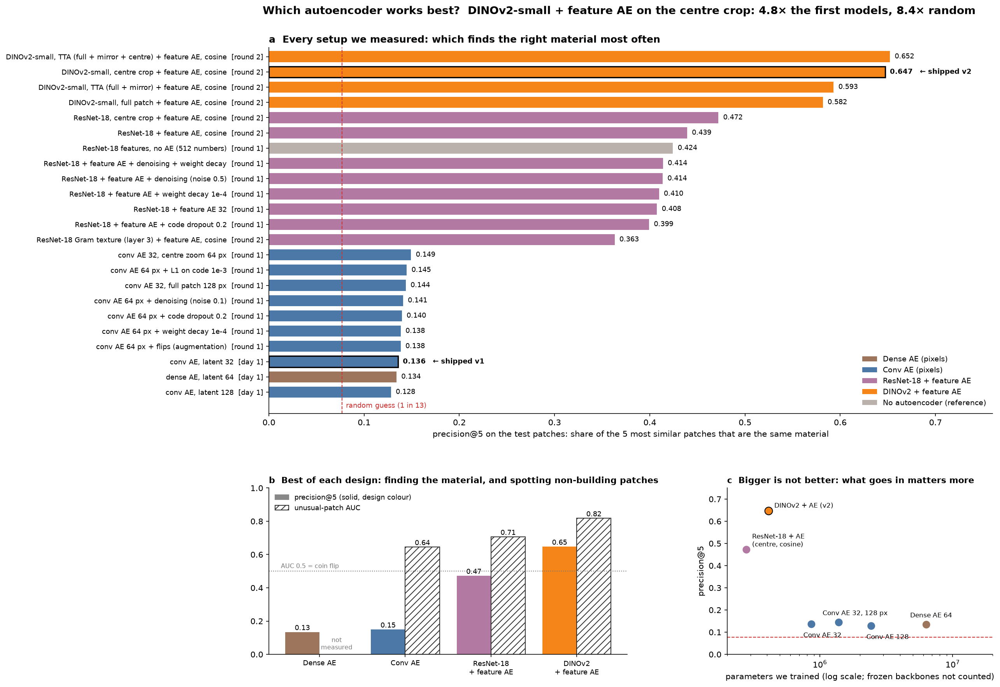
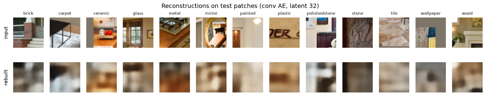
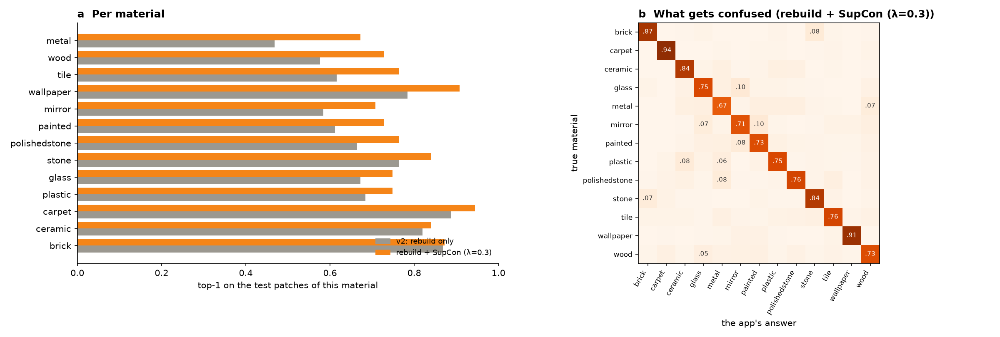
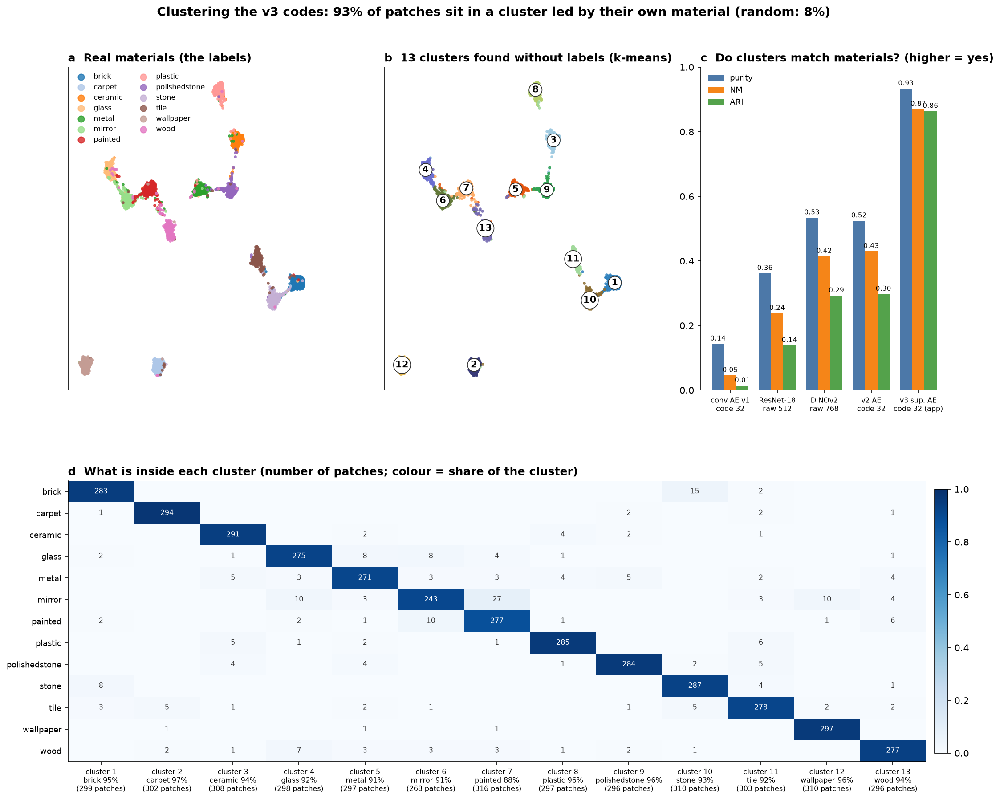

# 01_autoencoder · Material Finder model

**Use case.** An interior designer or architect uploads a photo of a surface (a wall, a floor, a facade) and wants
to know *what material is this, and what looks like it?* The autoencoder turns each photo into a short code of
32 numbers. Photos with close codes look alike, so **similarity search** in this latent space returns the most
similar material patches, and their labels give a material answer. The **reconstruction error** is a second
output: a high error means the photo does not look like a building material (an "unusual" hint).

**Model on Hugging Face:** [iaac-maai/hackathon-team7-material-finder-ae](https://huggingface.co/iaac-maai/hackathon-team7-material-finder-ae)
(current: v3, revision `cbe7297`; older versions are tagged `v2-dino-ae` and `v1-conv-ae`).
It is used by the model server in [`../02_model_server/`](../02_model_server) and the app in [`../03_app/`](../03_app).

## Dataset

| | |
|---|---|
| **Name** | MINC-2500 (Materials in Context), Bell et al., CVPR 2015 |
| **Source** | [mcimpoi/minc-2500_split_1](https://huggingface.co/datasets/mcimpoi/minc-2500_split_1) on Hugging Face (official split 1) |
| **Licence** | CC BY 4.0 |
| **Size** | 23 classes × 2,500 patches of 362 × 362 px, labelled at the patch centre |
| **What we use** | the **13 building materials** (brick, carpet, ceramic, glass, metal, mirror, painted, plastic, polished stone, stone, tile, wallpaper, wood): 27,625 train / 1,625 validation / 3,250 test patches. The other 10 classes (food, sky, skin, …; 2,500 test patches) only test the unusual score. |

The data is downloaded by the notebooks into `../data/` and is not committed.
The clean swatches in the app (1,280, CC0, ambientCG and Poly Haven via MatSynth) are made in `notebook/cc0_swatches.ipynb`.

## How to run

```bash
python -m venv .venv && source .venv/bin/activate
pip install -r 01_autoencoder/requirements.txt
hf download mcimpoi/minc-2500_split_1 --repo-type dataset --local-dir data/minc-2500
```

Then run the notebooks in `notebook/` from top to bottom, in this order. Each is saved with its outputs.

| Notebook | What it does |
|---|---|
| `autoencoder.ipynb` | **Monday:** split first, three setups on the same split and seed, similarity search, unusual score, ONNX export (model v1) |
| `improvements.ipynb` | Round 1: crops, resolution, five regularisers, ResNet-18 features + feature autoencoder |
| `improvements_round2.ipynb` | Round 2: DINOv2 features, centre crop, Gram texture features, test-time augmentation, cosine distance |
| `top_materials.ipynb` | Ranked material answers, top-k accuracy, calibration |
| `export_material_finder.ipynb` | Model v2: ONNX export (DINOv2 + feature AE), gallery, threshold, model card |
| `cc0_swatches.ipynb` | The 1,280 clean CC0 swatches and their codes |
| `supervised_ae.ipynb` | Supervised autoencoder experiment (3 seeds, choice of λ on validation) |
| `export_material_finder_v3.ipynb` | Model v3: the shipped model, measured with the ONNX file |

Figure scripts: `scripts/plot_models.py` (figures 20–21), `scripts/cluster_dinov2.py` (22–23), `scripts/cluster_v3.py` and `scripts/cluster_v3_test.py` (26–28).
The ONNX file, config and example inputs for the server are in `model_app/` (the `.onnx` file itself is on Hugging Face, not on GitHub).

## Setups compared

**Monday (`autoencoder.ipynb`):** three autoencoders on 64 × 64 pixels, same split, seed 42, 12 epochs.
precision@5 = share of the 5 nearest training patches with the right material (random: 0.077).

| Setup | Parameters | Train time (s) | Val MSE | Test MSE | precision@5 |
|---|---:|---:|---:|---:|---:|
| Dense AE, latent 64 | 6,337,088 | 256 | 0.0165 | 0.0162 | 0.134 |
| Conv AE, latent 32 (**v1**) | 863,587 | 950 | 0.0104 | 0.0104 | 0.136 |
| Conv AE, latent 128 | 2,436,547 | 1,137 | 0.0054 | 0.0054 | 0.128 |

The best rebuild (conv, latent 128) is not the best search: pixel autoencoders keep colour and layout, not material.
So we kept the autoencoder but changed **what goes into it**:

| Model | What goes in | Top-1 | precision@5 (app gallery) | Unusual ROC AUC |
|---|---|---:|---:|---:|
| v1 | 64 px pixels, conv AE | n/a | 0.14 (all train) | 0.65 |
| ResNet-18 + feature AE | ImageNet features, centre crop | n/a | 0.47 (all train) | n/a |
| v2 | frozen DINOv2-small, centre crop, feature AE 768→256→32→256→768 | 0.698 | 0.607 | 0.818 |
| **v3 (live)** | same as v2, loss = rebuild + 0.3 × supervised contrastive | **0.798** | **0.768** | **0.829** |

All v2/v3 numbers are measured with the ONNX file on the 3,250 test photos, searching the app's 3,900-patch gallery.

## Results



*Figure 21: all setups. Bigger models were not better; the input made the difference.*



*Figure 03: Monday reconstructions: colour and coarse layout survive, texture does not.*



*Figure 25: every material improved from v2 to v3; metal, wood and tile gained the most.*



*Figure 26: k-means on the v3 codes finds one cluster per material (purity 0.81 on unseen test patches, 0.54 for v2).*

More: training curves (`figures/02`), similarity rows (`figures/04`, `18`), the unusual histogram (`figures/07`),
the four architectures (`notebook/20`).

## Limitations

- **Only the centre is used.** MINC labels the patch centre, so the model looks at the middle half of the photo. Whole-room photos get the material in the middle, not the one the user means.
- **Tested on MINC, not on users' photos.** Phone photos in other light and at other distances may score lower.
- **Look-alike materials:** mirror and painted walls, glass and mirror, brick and stone are still confused; metal, mirror and painted are right first only about 70% of the time.
- **Most of the visual knowledge is in DINOv2** (22 M parameters, frozen, by Meta). We train only 410,912 parameters on top.
- **The unusual score is a hint:** skin and sky are flagged often, paper and fabric (which look like surfaces) rarely. About 5% of normal photos are flagged by design (95th percentile threshold).
