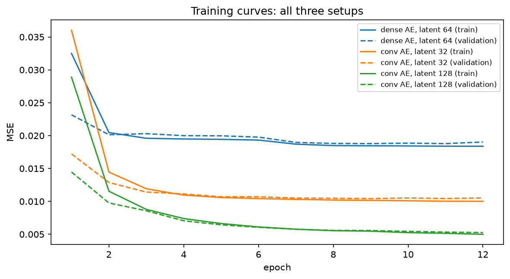
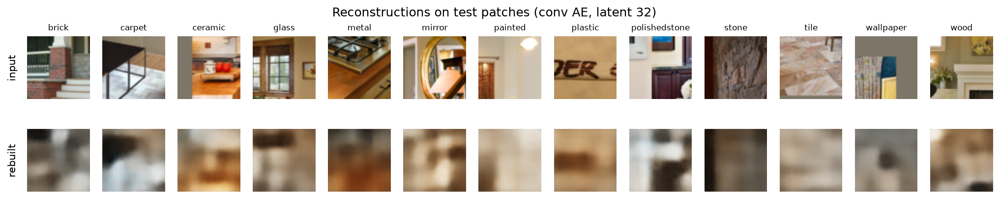
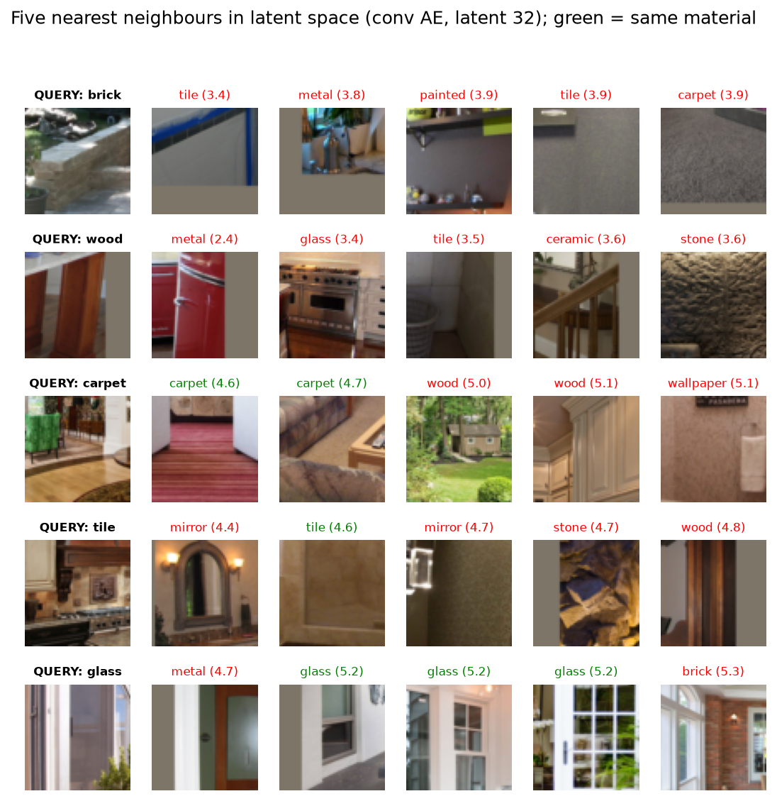
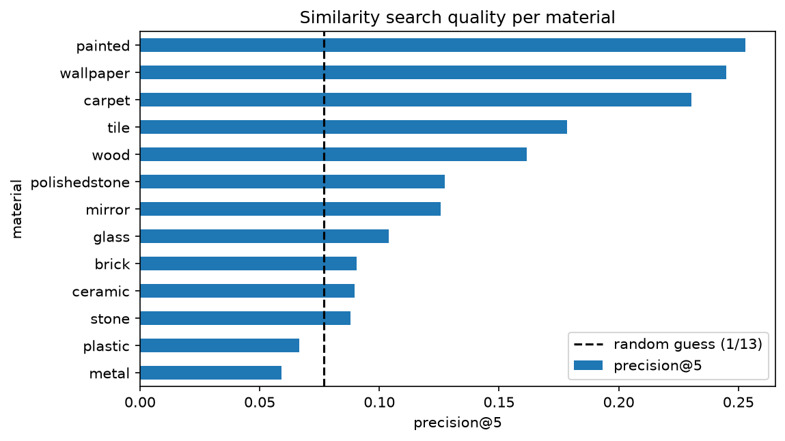
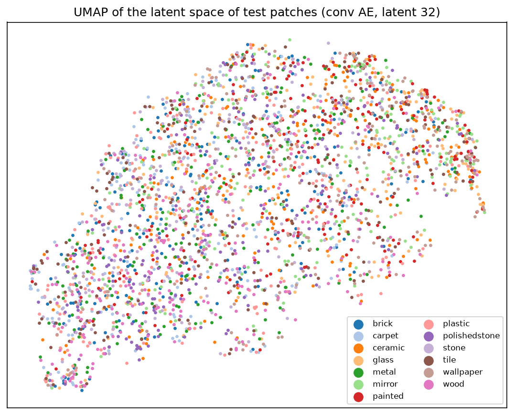
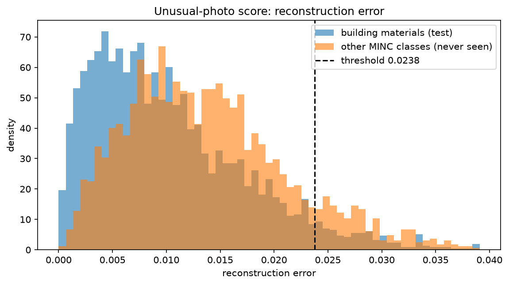

# Material Finder autoencoder (MINC-2500) · Team 7

A small convolutional autoencoder that turns a photo of a surface into a **32-number code**. Photos with close codes look alike. The model is the engine of a "find a material that looks like this" app: a user uploads a photo of a facade, floor or wall finish, and the app returns the 5 most similar patches from a gallery of 3,900 building-material patches, a material guess (majority vote of the 5), and an "unusual photo" hint.

**Made by:** Ugo, Alvaro, Sneha (team 7), AI Methods I hackathon, IAAC, November 2026.
**Code:** [github.com/iaac-maai/hackathon-team7-MINC_2500_material_patches](https://github.com/iaac-maai/hackathon-team7-MINC_2500_material_patches) (notebook: `01_autoencoder/notebook/autoencoder.ipynb`)

> **In short:** search works better than chance (precision@5 0.14 vs 0.077) but mostly matches **colour and layout**, not material. Read [Limitations](#limitations-where-it-fails) before using it.

---

## Files

| File | What it is |
|---|---|
| `material_ae.onnx` | The model. Input `image` (batch, 3, 64, 64) float32 in 0–1. Outputs `reconstruction` (batch, 3, 64, 64) and `code` (batch, 32) |
| `config.json` | Preprocessing, classes, threshold and results |
| `gallery_latents.npy` | Codes of the 3,900 gallery patches (300 per material), float32 (3900, 32) |
| `gallery_meta.json` | id, material and thumbnail path of each gallery patch |
| `gallery_thumbs/` | 64 × 64 JPEG thumbnails of the gallery patches |
| `material_ae.pt` | PyTorch weights (`state_dict` of `ConvAE(latent_dim=32)`), for further training |
| `figures/` | The figures on this card |

## Dataset

- **MINC-2500** (Materials in Context), Hugging Face mirror [`mcimpoi/minc-2500_split_1`](https://huggingface.co/datasets/mcimpoi/minc-2500_split_1), split 1.
- **Licence:** CC BY 4.0. **Cite:** Bell, Upchurch, Snavely and Bala (2015), *Material Recognition in the Wild with the Materials in Context Database*, CVPR.
- 23 classes × 2,500 patches of 362 × 362 px. We use the **13 building materials**: brick, carpet, ceramic, glass, metal, mirror, painted, plastic, polished stone, stone, tile, wallpaper, wood.
- **Split** (the official one): 27,625 train, 1,625 validation, 3,250 test patches. The 10 other classes (food, sky, skin, foliage…) are only used, from the test split, to test the unusual score.


## Model

**Preprocessing** (the same in training and on the server): RGB → centre-crop to a square → resize to 64 × 64 (PIL bilinear) → pixels / 255 → shape (1, 3, 64, 64).

**Architecture: `ConvAE`, latent size 32, 863,587 parameters**

```
encoder: Conv(3→32, 4, stride 2) → ReLU → Conv(32→64) → ReLU → Conv(64→128) → ReLU   64 → 32 → 16 → 8 px
         → Flatten → Linear(8192 → 32)                                                the code
decoder: Linear(32 → 8192) → ReLU → ConvT(128→64) → ReLU → ConvT(64→32) → ReLU
         → ConvT(32→3) → Sigmoid                                                      8 → 16 → 32 → 64 px
```

**Training:** MSE loss, Adam, learning rate 1e-3, batch size 128, 12 epochs, seed 42, Apple MPS. No labels are used for training.

## Comparison of setups

Same split, seed, epochs and learning rate. **precision@5** = for each test patch, the share of its 5 nearest training patches (Euclidean distance between codes) with the same material. Random guessing gives 1/13 ≈ 0.077.

| Setup | Parameters | Train time | Val MSE | Test MSE | precision@5 |
|---|---|---|---|---|---|
| Dense AE, latent 64 | 6,337,088 | 24 s | 0.0190 | 0.0188 | 0.129 |
| **Conv AE, latent 32** (this model) | **863,587** | 76 s | 0.0105 | 0.0104 | **0.140** |
| Conv AE, latent 128 | 2,436,547 | 78 s | 0.0053 | 0.0052 | 0.130 |

- Convolutions halve the error of the dense AE with 7× fewer parameters.
- A bigger code (128) halves the error again but does **not** find better neighbours: rebuilding well and searching well are different goals.
- We chose latent 32 for the best search quality and the smallest file (3.5 MB).



Validation follows training for all setups (no overfitting). The curves level off by about epoch 8.

## Results

### Reconstructions



The model keeps colour, brightness and the rough layout of a patch, and loses fine texture (brick joints, wood grain, tile edges).

### Similarity search (the use of this model)



- precision@5: **0.140** against the full training set, **0.126** against the 3,900-patch gallery the app uses. Random is 0.077.
- Best for even, coloured surfaces: painted (0.25), wallpaper (0.25), carpet (0.23), tile (0.18), wood (0.16).
- Worst: metal (0.06) and plastic (0.07), both below random.





### Unusual-photo score (bonus)

Score = reconstruction error. Threshold = 95th percentile on validation building patches (**0.0242**).



- Building materials vs the 10 other MINC classes: **ROC AUC 0.65**, precision 0.61, recall 0.11. 5.3% of building patches are flagged.
- Smooth images such as **sky** are rebuilt easily and slip through (2% flagged). Food and paper stand out most (16–19%). Glass scores as high as water or foliage.
- Use it as a soft hint ("results may be less reliable"), never as a verdict.

## Limitations (where it fails)

- **Colour, not material.** The codes group patches by colour, brightness and layout. Two brown photos match even if one is wood and one is leather.
- **Reflective and shiny materials** (metal, glass, mirror) show their surroundings, and plastic comes in every colour: search for these is at or below chance.
- **MINC patches are scenes, not close-ups.** The label only describes the material at the centre of the patch; the model encodes the whole scene.
- **Grey padding.** Patches cut at the edge of the original photo have grey filled corners, and the model matches these blocks (see the brick row in the similarity figure).
- **The unusual score measures how hard an image is to rebuild, not what it shows.**
- **Not tested on real phone photos yet.** Wider shots, other cameras and lighting may give worse results.
- Trained on 64 px images only: fine texture is gone before the model even sees it.

## How to use

```python
import json
import numpy as np
import onnxruntime as ort
from huggingface_hub import hf_hub_download
from PIL import Image

REPO = "iaac-maai/hackathon-team7-material-finder-ae"
files = {name: hf_hub_download(REPO, name)
         for name in ["material_ae.onnx", "config.json", "gallery_latents.npy", "gallery_meta.json"]}
session = ort.InferenceSession(files["material_ae.onnx"])
config = json.load(open(files["config.json"]))
gallery = np.load(files["gallery_latents.npy"])
meta = json.load(open(files["gallery_meta.json"]))


def preprocess(image, size=64):
    # RGB, centre square, 64 x 64, 0-1, shape (1, 3, 64, 64)
    image = image.convert("RGB")
    w, h = image.size
    s = min(w, h)
    image = image.crop(((w - s) // 2, (h - s) // 2, (w - s) // 2 + s, (h - s) // 2 + s))
    x = np.asarray(image.resize((size, size), Image.BILINEAR), dtype=np.float32) / 255.0
    return x.transpose(2, 0, 1)[None]


x = preprocess(Image.open("my_surface.jpg"))
reconstruction, code = session.run(None, {"image": x})

distances = np.linalg.norm(gallery - code, axis=1)
top5 = np.argsort(distances)[:5]
materials = [meta[i]["material"] for i in top5]
guess = max(set(materials), key=materials.count)
unusual = float(((reconstruction - x) ** 2).mean()) > config["unusual_threshold"]

print("5 nearest:", [(meta[i]["material"], round(float(distances[i]), 2)) for i in top5])
print(f"guess: {guess} ({materials.count(guess)}/5), unusual photo: {unusual}")
```

## Licence

Code and model: MIT. The training data (MINC-2500) is CC BY 4.0: credit Bell et al. (2015) when you use the model or the gallery thumbnails.
