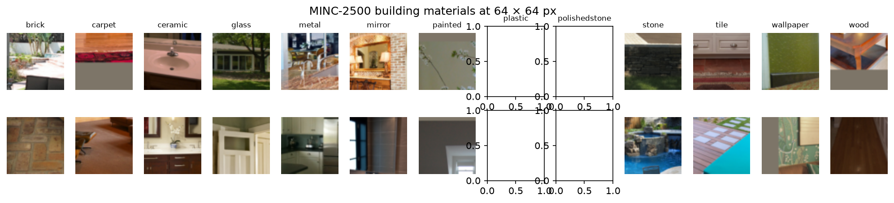
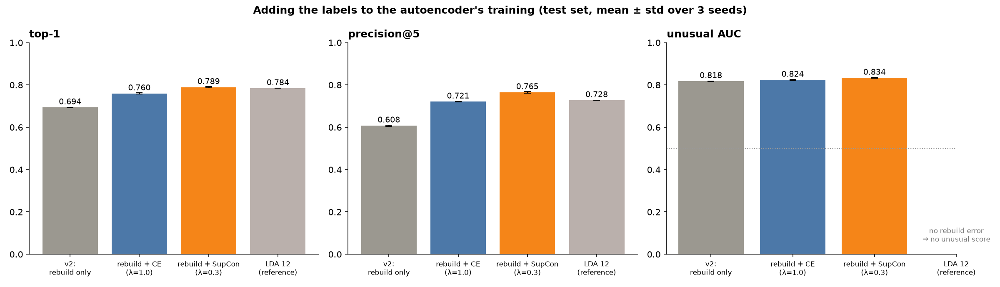
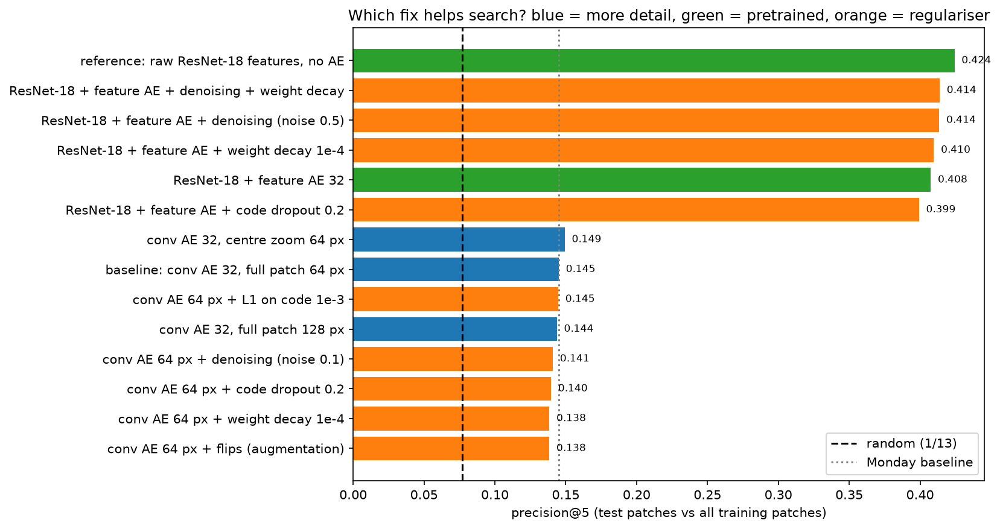
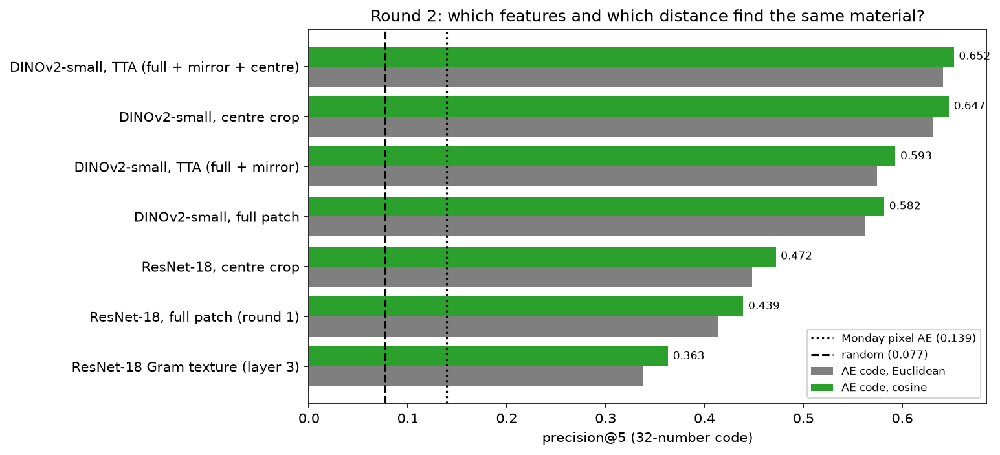
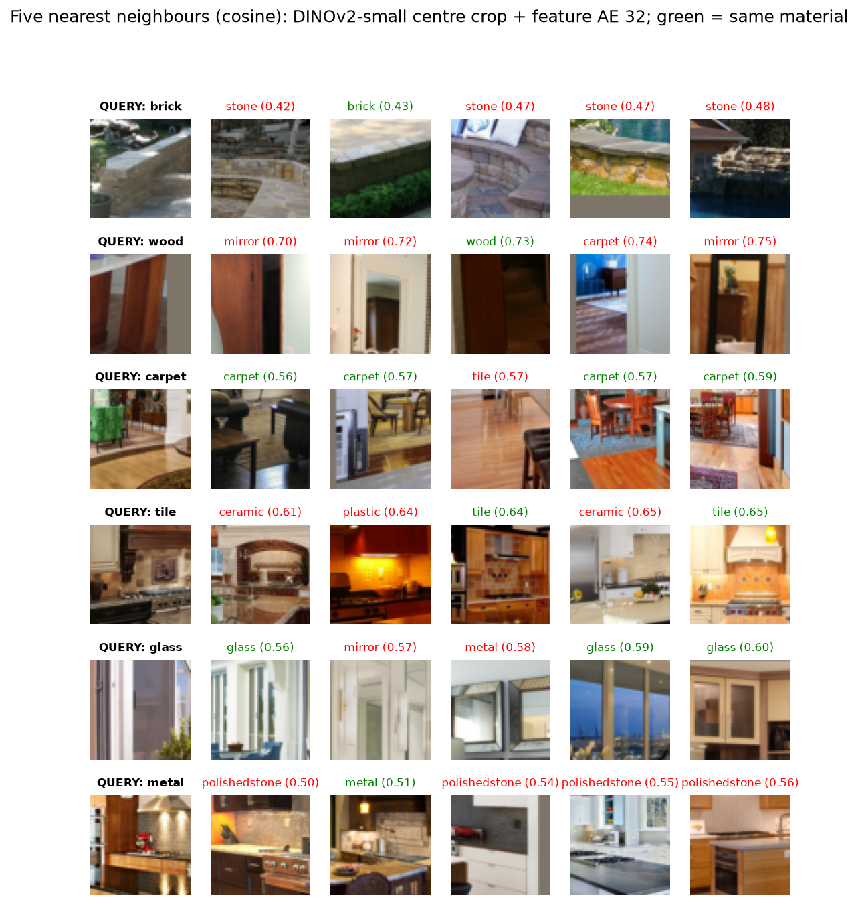
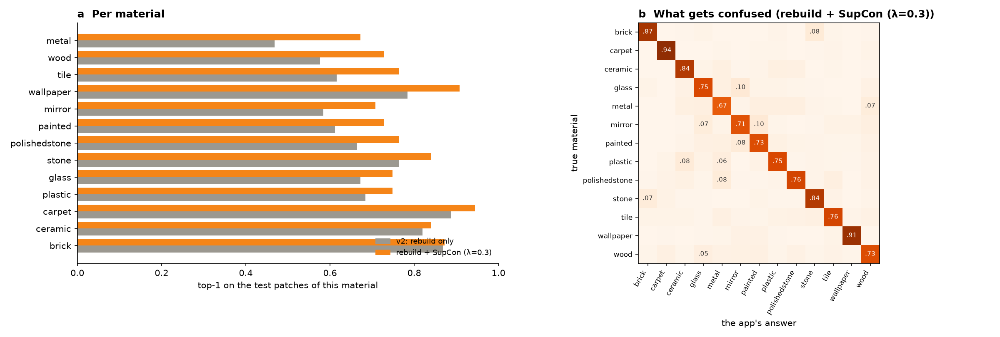
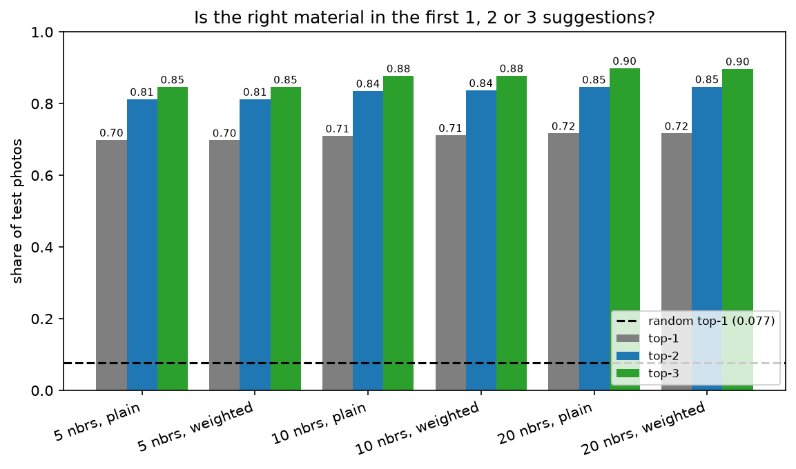
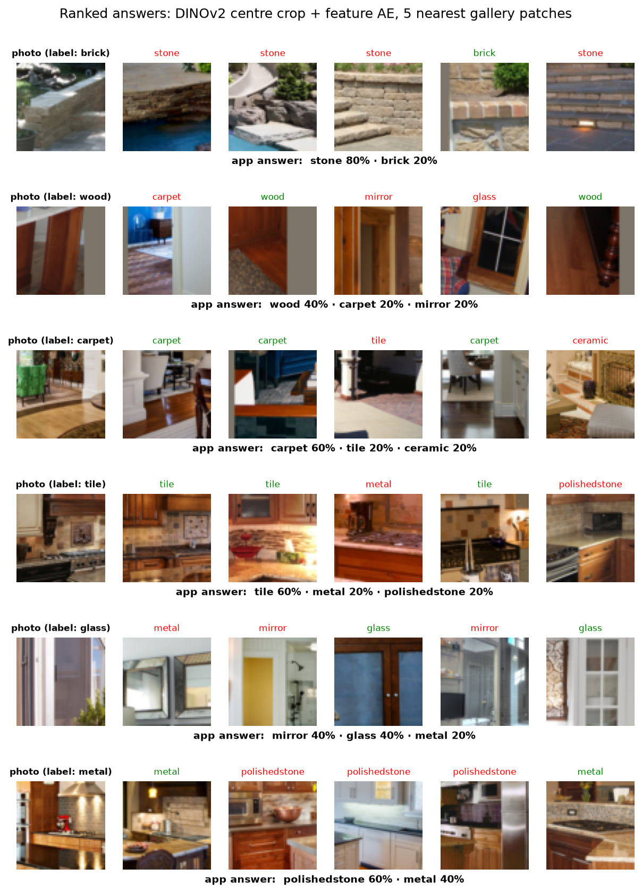

# Material Finder v3 (MINC-2500) · Team 7

Upload a photo of a surface (a facade, floor or wall finish) and get the **5 most similar patches** from a gallery of 3,900 building-material patches, a **ranked material answer** ("carpet 60% · tile 20% · ceramic 20%") and an **"unusual photo"** hint.

**How it works:** the photo's centre goes through a frozen, pretrained **DINOv2-small**, which describes it in 768 numbers. **Our autoencoder** squeezes these into a **32-number code**. In v3 it is a **supervised autoencoder**: it learns to rebuild the 768 numbers *and* to pull codes of the same material together (a supervised contrastive loss). Patches whose codes point the same way (cosine distance) look alike.

**Made by:** Ugo, Alvaro, Sneha (team 7), AI Methods I hackathon, IAAC, November 2026.
**Code:** [github.com/iaac-maai/hackathon-team7-MINC_2500_material_patches](https://github.com/iaac-maai/hackathon-team7-MINC_2500_material_patches) (`01_autoencoder/notebook/`)

> **In short:** the right material is the first suggestion for **80%** of test photos and in the **top 3 for 88%** (random: 8%). precision@5 in the app's gallery = **0.77**, up from 0.61 in v2 and 0.14 for our first, pixel-based autoencoder. Metal, mirror and painted walls are still the hardest. Read [Limitations](#limitations-where-it-fails) before using it.

---

## Files

| File | What it is |
|---|---|
| `material_finder.onnx` | The whole model, 90 MB. Input `image` (batch, 3, 224, 224) float32 in 0–1. Outputs `code` (batch, 32), length 1, and `unusual_score` (batch,) |
| `config.json` | Preprocessing, classes, settings (5 neighbours, minimum share 0.2), threshold and results |
| `gallery_latents.npy` | Codes of the 3,900 gallery patches (300 per material), float32 (3900, 32) |
| `gallery_meta.json` | Training-set id, material and thumbnail path of each gallery patch |
| `gallery_thumbs/` | 256 × 256 JPEG thumbnails of the gallery patches |
| `swatch_latents.npy`, `swatch_meta.json` | Codes and details (name, material, colour, source, link) of 1,280 clean CC0 swatches from ambientCG and Poly Haven, listed by MatSynth |
| `swatch_thumbs/`, `swatch_spheres/` | Flat swatch crops and sphere previews of those swatches |
| `material_finder_ae.pt` | PyTorch weights of our feature autoencoder, plus the feature mean and std and λ, for further training |
| `examples/` | 4 test photos (brick, carpet, tile, wood) |
| `figures/` | The figures on this card |

## Dataset

- **MINC-2500** (Materials in Context), Hugging Face mirror [`mcimpoi/minc-2500_split_1`](https://huggingface.co/datasets/mcimpoi/minc-2500_split_1), split 1.
- **Licence:** CC BY 4.0. **Cite:** Bell, Upchurch, Snavely and Bala (2015), *Material Recognition in the Wild with the Materials in Context Database*, CVPR.
- 23 classes × 2,500 patches of 362 × 362 px. We use the **13 building materials**: brick, carpet, ceramic, glass, metal, mirror, painted, plastic, polished stone, stone, tile, wallpaper, wood.
- **Split** (the official one): 27,625 train, 1,625 validation, 3,250 test patches. The 10 other classes (food, sky, skin, foliage…) are used only from the test split, to test the unusual score.



## Model

**Preprocessing** (the same in training and on the server): RGB → centre square → keep its **middle half** → resize to 224 × 224 (PIL bilinear) → pixels / 255 → shape (1, 3, 224, 224). MINC labels describe the material at the centre of a patch, so the middle half removes most of the surrounding scene.

**Inside the ONNX file:**

```
image (224 px, 0-1) → ImageNet normalisation
  → DINOv2-small, frozen (22 M parameters, not trained by us)
  → class token + mean patch token = 768 features → standardised with the training mean and std
  → our encoder: Linear(768 → 256) → ReLU → Linear(256 → 32)          the code, scaled to length 1
  → our decoder: Linear(32 → 256) → ReLU → Linear(256 → 768)          only for the unusual score
```

**Training (our part only):** 410,912 parameters. Loss = **rebuild error + 0.3 × supervised contrastive loss**:
- rebuild error: MSE on the standardised features, denoising (Gaussian noise 0.5 on the input, clean target), as in v2. It keeps the unusual score working;
- supervised contrastive loss (Khosla et al. 2020, temperature 0.1) on the length-1 code: in each batch, codes of the same material are pulled together and the others pushed apart. λ = 0.3 was chosen on the validation set (`supervised_ae_final.ipynb`).

AdamW with learning rate 1e-3 and weight decay 1e-4, batch size 256, 30 epochs, seed 42. The labels are the 13 MINC training labels; validation and test labels are never used for training.

**Search:** Euclidean distance between length-1 codes, which equals cosine distance. Take the 5 nearest gallery patches; each material's share = its votes / 5. Show the materials with a share of at least 0.2, at most 3.

## How we got here

All setups use the same split, seed and metric. **precision@5** = for each test patch, the share of its 5 nearest training patches with the same material. Random = 1/13 ≈ 0.077.

| Step | Setup | precision@5 |
|---|---|---|
| Monday (v1) | Conv autoencoder on 64 px pixels, latent 32, Euclidean | 0.140 |
| Round 1 | + more pixels, centre zoom, 5 regularisers | 0.138–0.149 |
| Round 1 | Frozen ResNet-18 + feature autoencoder | 0.414 |
| Round 2 | ResNet-18 Gram texture features | 0.363 |
| Round 2 | DINOv2-small, full patch, cosine | 0.582 |
| Round 2 | DINOv2-small, centre crop, cosine (v2) | 0.647 |
| Round 2 | DINOv2-small, average of full + mirror + centre, cosine | 0.652 |
| **Supervised** | **DINOv2-small, centre crop, supervised autoencoder (rebuild + contrastive), cosine (v3, this model)** | **0.765** in the gallery (mean of 3 seeds) |

- Regularisers and more pixels barely changed a pixel autoencoder: at 64 px it learns colour, not material.
- A pretrained network in front tripled the score; DINOv2 (self-supervised) beat ResNet-18 (ImageNet labels) by about 0.15.
- The centre crop added 0.07; cosine distance added about 0.02 everywhere.
- Averaging 3 views added only 0.005 for 3× the work, so we use the centre crop alone.
- Compressing 768 features to 32 numbers costs little: the raw features score 0.661.
- **The labels were the missing piece.** v2's autoencoder never saw them, so its code kept whatever DINOv2 finds important, including the room around the material. Adding a supervised contrastive term lifted top-1 from 0.69 to 0.79 and precision@5 from 0.61 to 0.77 (3 seeds, test set), and every material improved; a classifier term (cross-entropy) gave less (0.76).







## Results

Measured with `material_finder.onnx` on the real test photos, searching the app's 3,900-patch gallery.

| Measure | Value |
|---|---|
| Right material is the first suggestion (top-1) | **0.798** (v2: 0.698) |
| … in the first 2 suggestions | 0.867 (v2: 0.812) |
| … in the first 3 suggestions | **0.879** (v2: 0.846) |
| precision@5 in the gallery | 0.768 (v2: 0.607) |
| Materials shown per photo (share ≥ 0.2) | 1.4 on average (v2: 2.0): v3 is more decided |
| Nearest clean swatch is a matching material / any of 5 | 0.49 / 0.73 (v2: 0.40 / 0.65) |
| Unusual score: ROC AUC, building vs the 10 other classes | 0.829 (v2: 0.818) |

### Similarity search



These six queries are among the harder cases (12 of 30 matches correct, against 65% on average). Many "wrong" matches show a sensible neighbour: stone walls for a brick wall, wooden floors next to carpets. MINC gives each patch **one** label, for its centre, while most patches show several materials.

### Per material



Top-1 per material, v2 vs v3 (from `supervised_ae_final.ipynb`, seed 42). Every material improves; the weakest gain most: metal 0.47 → 0.67, wood 0.58 → 0.73, tile 0.62 → 0.76. Mirror and painted walls are still often confused with each other.

The figures below are from **v2** (`top_materials_final.ipynb`), kept to show how the ranked answer works:





### Unusual-photo score (bonus)

Score = how badly the autoencoder rebuilds the DINOv2 features. Threshold = 95th percentile on validation building patches.

- 4.8% of building test photos are flagged, against 43% of the other classes (AUC 0.83; v2 0.82, the first model 0.65).
- Most often flagged: skin (75%), hair (68%), sky (62%). Least: paper (12%), fabric (20%), leather (23%), which look like surfaces.
- Use it as a soft hint ("this may not be a building material"), never as a verdict.

## Limitations (where it fails)

- **One label per patch.** MINC patches are scenes, labelled only at the centre. Many "wrong" matches contain the query material somewhere else, so our scores understate how useful the matches are, and the user may mean a different surface than the centre.
- **Scene still matters, less than before.** The labels taught the code to care about the material more than the room, but metal (top-1 0.67), mirror (0.71) and painted (0.73) are still the weakest; mirror and painted walls are confused with each other.
- **Pretrained backbone.** DINOv2 was trained by Meta on 142 million images without labels. Our part, the autoencoder, is trained with the 13 MINC training labels; most of the quality still comes from DINOv2.
- **Only 13 classes.** The contrastive loss pulls codes into 13 groups, so "more like this" may now favour the same material over a similar look in another material.
- **Size and speed.** 90 MB, about 37 ms per photo on a laptop CPU, including decoding (418 s for 11,275 photos). Not tested yet on Render's free server.
- **Not tested on real phone photos yet.** Wider shots, other cameras and lighting may give worse results. A close-up, or cropping to the surface, should help.

## How to use

```python
import json
import numpy as np
import onnxruntime as ort
from huggingface_hub import hf_hub_download
from PIL import Image

REPO = "iaac-maai/hackathon-team7-material-finder-ae"
files = {name: hf_hub_download(REPO, name)
         for name in ["material_finder.onnx", "config.json", "gallery_latents.npy", "gallery_meta.json"]}
session = ort.InferenceSession(files["material_finder.onnx"])
config = json.load(open(files["config.json"]))
gallery = np.load(files["gallery_latents.npy"])
meta = json.load(open(files["gallery_meta.json"]))


def preprocess(image):
    # RGB, centre square, its middle half, 224 x 224, 0-1, shape (1, 3, 224, 224)
    image = image.convert("RGB")
    w, h = image.size
    s = min(w, h)
    image = image.crop(((w - s) // 2, (h - s) // 2, (w - s) // 2 + s, (h - s) // 2 + s))
    half, off = int(s * 0.5), (s - int(s * 0.5)) // 2
    image = image.crop((off, off, off + half, off + half)).resize((224, 224), Image.BILINEAR)
    return (np.asarray(image, dtype=np.float32) / 255.0).transpose(2, 0, 1)[None]


code, unusual_score = session.run(None, {"image": preprocess(Image.open("my_surface.jpg"))})

distances = np.linalg.norm(gallery - code, axis=1)        # codes have length 1: this is cosine search
top5 = np.argsort(distances)[:5]
materials = [meta[i]["material"] for i in top5]
ranked = sorted(set(materials), key=lambda m: (-materials.count(m), materials.index(m)))
answer = [(m, materials.count(m) / 5) for m in ranked[:3] if materials.count(m) / 5 >= config["min_share"]]

print("5 nearest:", [(meta[i]["material"], round(float(distances[i]), 2)) for i in top5])
print("answer:", " · ".join(f"{m} {share:.0%}" for m, share in answer))
print("unusual photo:", bool(unusual_score[0] > config["unusual_threshold"]))
```

## Version history

- **v3 (this version, 18 Nov 2026):** the same network and files as v2, trained as a supervised autoencoder (rebuild + 0.3 × supervised contrastive loss). Top-1 0.698 → 0.798, precision@5 0.607 → 0.768.
- **v2 (17 Nov 2026):** frozen DINOv2-small, centre crop, feature autoencoder, cosine distance, ranked answers. Still available at the git tag [`v2-dino-ae`](https://huggingface.co/iaac-maai/hackathon-team7-material-finder-ae/tree/v2-dino-ae).
- **v1 (16 Nov 2026):** convolutional autoencoder on 64 × 64 pixels, latent 32, precision@5 0.140. It matched colour and layout more than material. Still available at the git tag [`v1-conv-ae`](https://huggingface.co/iaac-maai/hackathon-team7-material-finder-ae/tree/v1-conv-ae).

## Licence

Our code and autoencoder: MIT. DINOv2-small (inside the ONNX file): Apache 2.0, © Meta. The training data and the gallery thumbnails (MINC-2500) are CC BY 4.0: credit Bell et al. (2015).
