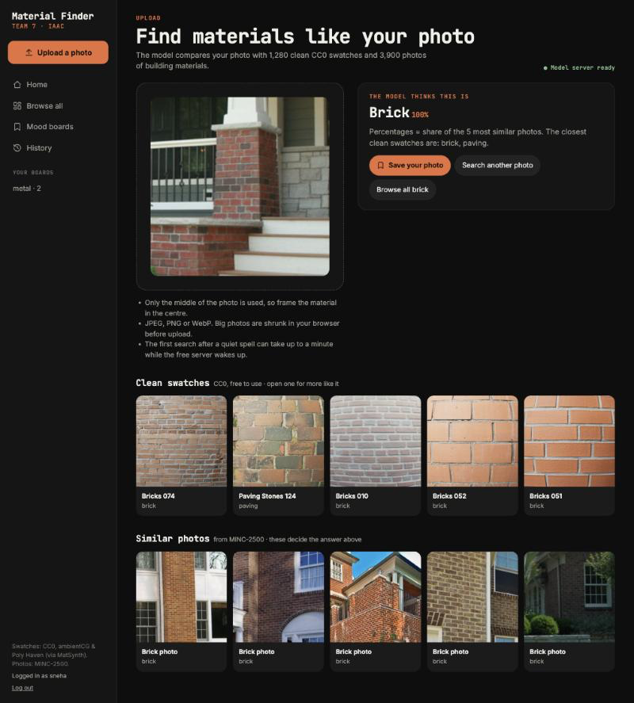

# PROOFS · Material Finder (Team 7)

Commands run on 19 November 2026 against the live app **https://team7-material-finder.pages.dev**.
We did not add user accounts (one shared team password, plus a name for the activity log), so proofs 5 and 6 do not apply.

## 1. A database

```bash
cd 03_app
npx wrangler d1 execute team7-material-finder-db --remote --command "SELECT name FROM sqlite_master WHERE type='table' ORDER BY name"
```

```json
"results": [
  { "name": "_cf_KV" },
  { "name": "board_items" },
  { "name": "boards" },
  { "name": "events" },
  { "name": "searches" },
  { "name": "sqlite_sequence" }
],
"success": true,
"served_by_region": "WEUR"
```

`searches` (one row per uploaded photo), `boards` and `board_items` (mood boards), `events` (activity log for the admin
dashboard). `_cf_KV` and `sqlite_sequence` are made by Cloudflare and SQLite. The tables are defined in [`../03_app/schema.sql`](../03_app/schema.sql).

## 2. Locked on the server

Without the login cookie, the API answers **401** and no data:

```bash
curl -i https://team7-material-finder.pages.dev/api/history
```

```
HTTP/2 401
content-type: application/json
server: cloudflare

{"error":"Not logged in"}
```

The admin dashboard has its own lock (`ADMIN_PASSWORD`); the team login does not open it:

```bash
curl -s -o /dev/null -w "%{http_code}\n" https://team7-material-finder.pages.dev/api/admin/summary
401
```

Pages without the cookie redirect to `/login` (302). The check is in [`../03_app/functions/_middleware.js`](../03_app/functions/_middleware.js),
which runs before every request. The shared team password is still required for everyone.

## 3. Connected to Render

`MODEL_URL` in [`../03_app/wrangler.toml`](../03_app/wrangler.toml):

```toml
MODEL_URL = "https://team7-material-finder.onrender.com"
```

Screenshot of one live result in the app (20 November 2026): `02_model_server/examples/brick.jpg` uploaded on the Upload page, answered "Brick 100%" with five clean swatches and five similar MINC photos:



## 4. No secrets in git

`.gitignore` (excerpt):

```gitignore
*.onnx
*.pt
.env
.dev.vars
```

```bash
git ls-files | grep -E "\.dev\.vars|\.env$|\.onnx$|\.pt$|\.npy$"
# (no output: none of these files is tracked)
```

**Our AI tool's answer to "Check my repo and my Cloudflare account for secrets that are in code or in the git history"**
(Claude Code, 19 November 2026):

> - **Repository, current files:** no `.dev.vars`, `.env`, tokens or model files are tracked. `wrangler.toml` holds only
>   plain settings (`MODEL_URL`, the D1 and R2 bindings); the D1 `database_id` is an identifier, not a secret.
> - **Git history:** searched every commit (`git log --all -p`) for Hugging Face tokens (`hf_…`), GitHub tokens (`ghp_…`),
>   API keys (`sk-…`), Cloudflare API tokens and `APP_PASSWORD=` / `ADMIN_PASSWORD=` with a value. The only matches are
>   comments that say *put APP_PASSWORD=... in a .dev.vars file*; no real value was ever committed.
> - **Cloudflare account:** the Pages project `team7-material-finder` has two secrets, `APP_PASSWORD` and `ADMIN_PASSWORD`,
>   both stored encrypted (`wrangler pages secret list` shows "Value Encrypted"). They were typed into Cloudflare by the
>   team in a terminal and never appeared in code, chat or the repository.
> - **Hugging Face:** the model repository holds only the ONNX model, codes, thumbnails, config and model card; no token.

The app password is sent to the instructors with the course hand-in, not in this repository.
