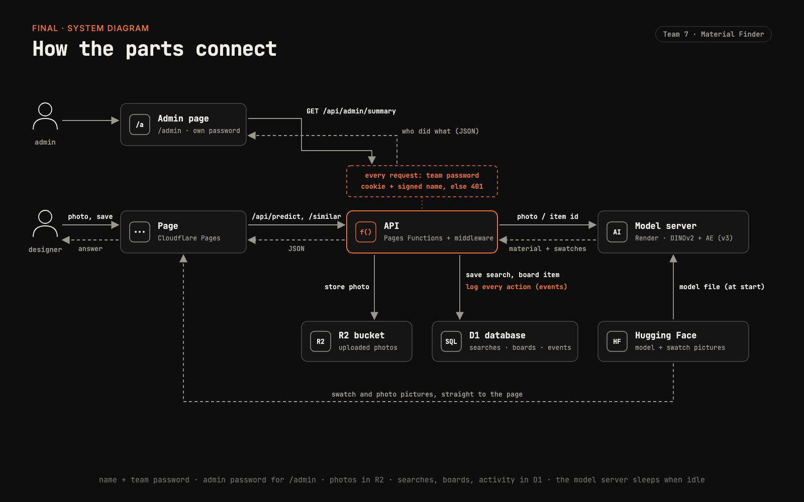
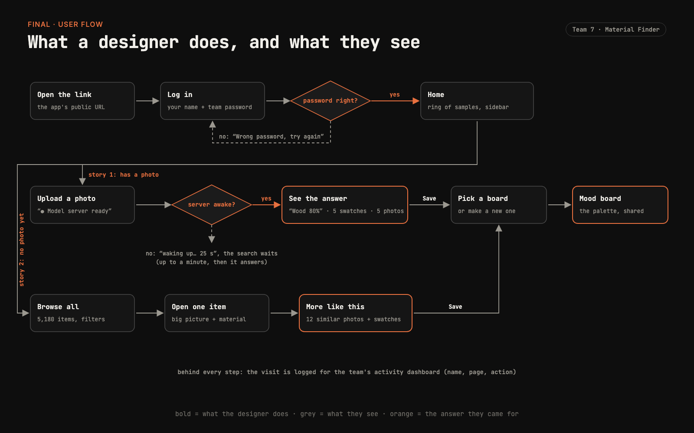
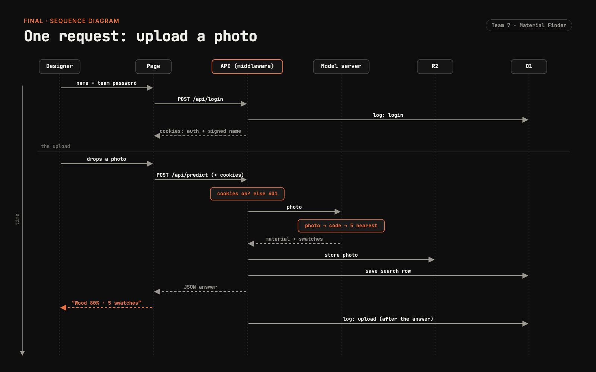

# 04_final · Material Finder (Team 7)

**Team:** Ugo, Alvaro, Sneha · AI Methods I hackathon, IAAC, 16–20 November 2026

## Use case

An **interior designer** sees a surface they like (a floor, a wall, a facade) and wants to know *what material is this,
and what looks like it?* They upload a photo. Material Finder answers with the material (for example "Wood 80%"),
**five clean CC0 swatches** they can use in a palette, and **five similar photos** of real buildings, and they save the
best ones to a **mood board** for their client. Without a photo, they can browse all 5,180 photos and swatches and ask
for "more like this". A photo that does not look like a building material gets a soft "unusual" warning.

## Live

| Part | URL |
|---|---|
| **App** (Cloudflare Pages, password protected) | https://team7-material-finder.pages.dev |
| **Model server** (Render, Gradio + ONNX Runtime) | https://team7-material-finder.onrender.com |
| **Model** (Hugging Face, v3 = revision `cbe7297`) | https://huggingface.co/iaac-maai/hackathon-team7-material-finder-ae |
| **Admin activity dashboard** (own password) | https://team7-material-finder.pages.dev/admin |

**Log in:** your name and the team password (sent with the course hand-in, never in this repository).
**The model server sleeps** after 15 minutes without use; the Upload page shows "Model server waking up… N s" and the
first search can take about a minute.

**The final app's code** is in [`../03_app/`](../03_app) (one app, grown since Wednesday). The model is made in
[`../01_autoencoder/`](../01_autoencoder) and served by [`../02_model_server/`](../02_model_server).
Proofs: [`PROOFS.md`](PROOFS.md).

## What changed since Wednesday

- **Model v3:** the feature autoencoder now also learns from the labels (rebuild error + supervised contrastive loss).
  Right material first: 69.8% → **79.8%**; precision@5 in the app gallery: 0.607 → **0.768**; unusual-photo ROC AUC 0.818 → 0.829.
- **Login with a name** and an **admin activity dashboard** (`/admin`): who logged in, from which city and device, what
  they opened, uploaded and saved, failed logins, actions per day. One row per action in the D1 table `events`; no IP addresses.
- **Wake-up:** the Upload page checks the model server every 5 seconds and shows how long it has been waiting.

## Diagrams

Made with [`diagrams/src/diagrams.html`](diagrams/src/diagrams.html), exported with `sh diagrams/src/export.sh`.
Every arrow is a call in the code (file in brackets below).

**System:** the parts and who talks to whom.

**User flow:** what a designer does, and what they see.

**Sequence:** one request, uploading a photo.

| Arrow | Code |
|---|---|
| Page → API `POST /api/predict`, `GET /api/similar` | `03_app/public/upload.js`, `03_app/public/app.js` |
| login check, cookies, 401 | `03_app/functions/_middleware.js`, `03_app/functions/api/login.js` |
| API → model server | `03_app/lib/model.js` (Gradio HTTP API, two steps: POST, then GET the result) |
| API → R2 (store photo), API → D1 (search row) | `03_app/functions/api/predict.js` |
| API → D1 (board items) | `03_app/functions/api/boards/` |
| API → D1 (log every action) | `03_app/lib/activity.js`, called by the middleware |
| Admin page → `GET /api/admin/summary` | `03_app/public/admin.js`, `03_app/functions/api/admin/summary.js` |
| Hugging Face → model server (model file at start) | `02_model_server/app/model.py` (`HF_REVISION`) |
| Hugging Face → page (pictures) | `03_app/public/data/catalog.json` (thumbnail URLs on the pinned revision) |

## Three statements

**What is clear:**

1 : What goes into the autoencoder matters more than how big it is. Our pixel autoencoders learned colour and layout, not material.When we fed the same kind of autoencoder DINOv2 features instead of pixels, precision went from 0.14 to 0.61.

**What is still unclear:**

1 : We don’t know why mirror, glass and painted walls are still confused. It could be the model, the labels, or the fact that these materials reflect their surroundings and really do look alike.

**What we would do next:**

1 : Let the user tap the surface they want, instead of always using the centre of the photo. Whole-room photos would then work.

2 : Add more design themes, not just material filters.

3 : Add user accounts with private mood boards, and move the model server to a plan that doesn’t sleep.

## Limitations

- **Only the middle of the photo is used.** The model was trained on MINC patches labelled at their centre. In a whole-room photo it judges what is in the middle, not necessarily the surface the user means.
- **Tested on MINC test photos, not on users' photos.** All accuracy numbers come from the MINC-2500 test split; phone photos in other light may score lower.
- **Look-alike materials:** mirror and painted walls, glass and mirror, brick and stone are still confused. Metal, mirror and painted are right first only about 70% of the time.
- **No clean swatches for carpet, glass, mirror or wallpaper** (the CC0 libraries have none); the app says so and shows the closest other materials.
- **One shared password, no user accounts.** The name at login is not checked (anyone with the password can type any name); all mood boards are shared by the team.
- **Free hosting:** the model server sleeps after 15 minutes and needs about a minute to wake up; Render's free plan has 512 MB of memory.
