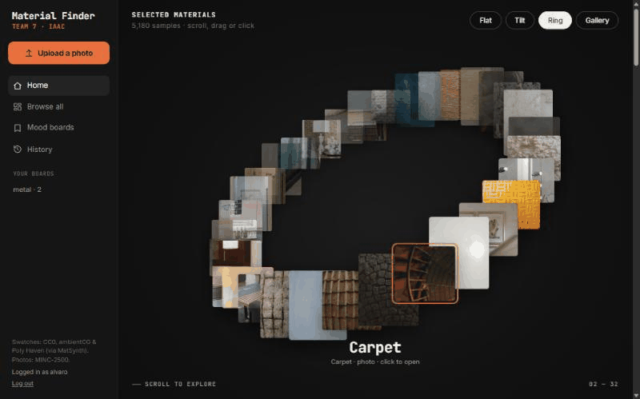
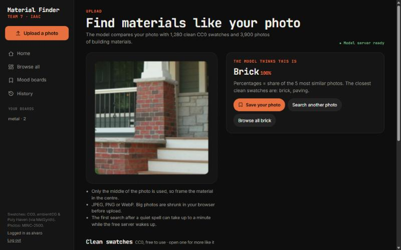
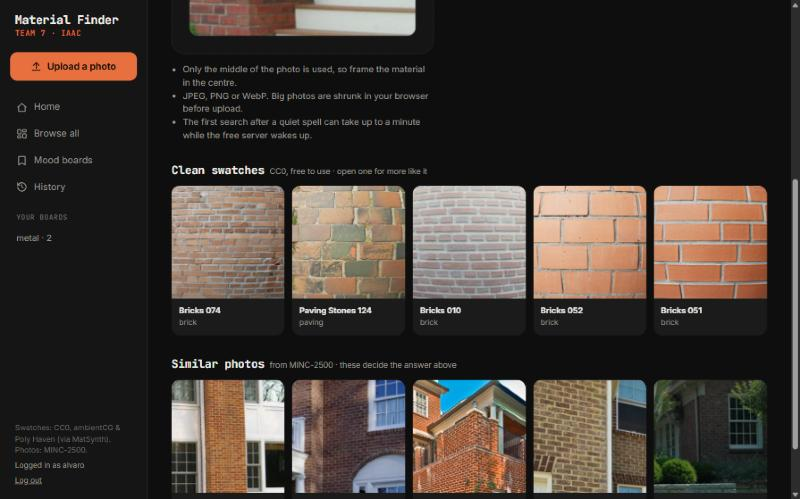
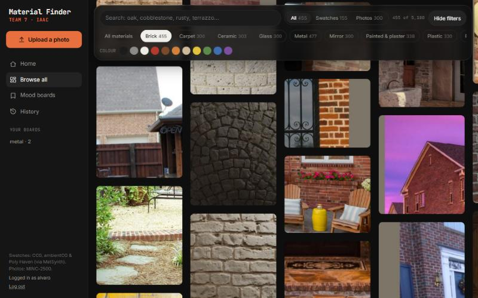
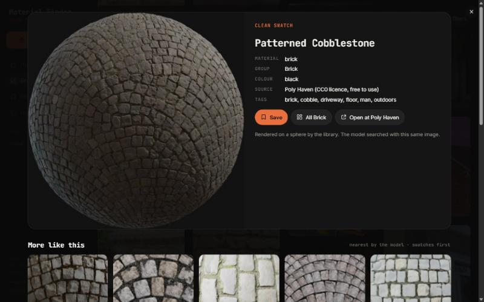
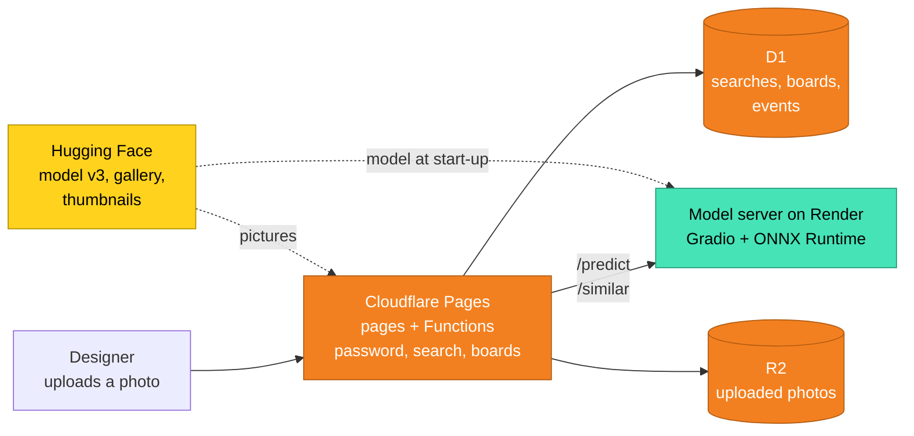
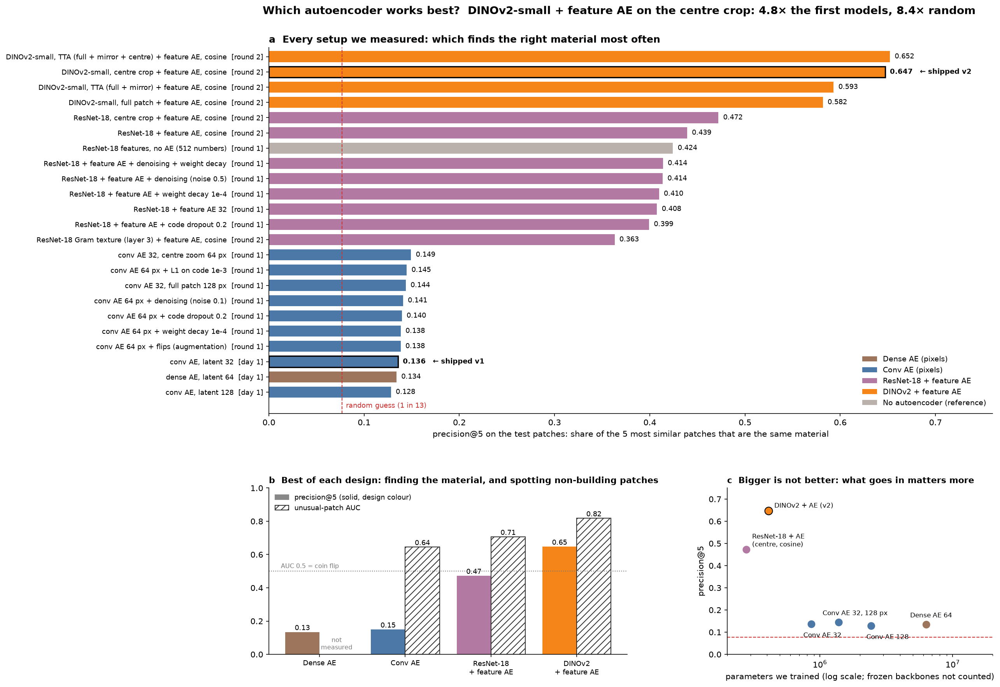

# Material Finder · Team 7

**Point your phone at a wall. Get the material, five clean swatches, and five real buildings that use it.**

Ugo, Alvaro, Sneha · AI Methods I hackathon, IAAC MaAI 2026/27 (16 to 20 November 2026)

[](https://team7-material-finder.pages.dev)
[](https://team7-material-finder.onrender.com)
[](https://huggingface.co/iaac-maai/hackathon-team7-material-finder-ae)
[](https://huggingface.co/datasets/mcimpoi/minc-2500_split_1)
[](LICENSE)

**[Open the app](https://team7-material-finder.pages.dev)** · [model server](https://team7-material-finder.onrender.com) · [model on Hugging Face](https://huggingface.co/iaac-maai/hackathon-team7-material-finder-ae) · [final report](04_final/README.md) · [proofs](04_final/PROOFS.md)

[](docs/images/app_tour.gif)

---

## The idea

An interior designer walks past a facade they love. *What is that, and where do I get something like it?*

They take a photo and upload it. Material Finder answers in a few seconds:

1. **The material**, ranked: "Brick 100%", or "ceramic 60% · tile 40%" when it is less sure.
2. **Five clean CC0 swatches** they can drop straight into a render or a palette.
3. **Five similar real photos** from MINC-2500, the ones that decided the answer.
4. A soft **"unusual"** warning when the photo does not look like a building material at all.

They save what they like to a **mood board** for their client. No photo at hand? They can browse all
**5,180 samples** (3,900 photos and 1,280 swatches) on an endless canvas and click *More like this* on any of them.

## The app

| Upload a photo | ...and get matches |
|---|---|
| [](docs/images/03_upload_result.jpg) | [](docs/images/04_upload_matches.jpg) |
| **Browse 5,180 samples** | **More like this** |
| [](docs/images/02_browse.jpg) | [](docs/images/05_more_like_this.jpg) |

| Page | What it does |
|---|---|
| **Home** | A turning ring of samples, two per material. Scroll, drag or click to bring one to the front |
| **Browse** | Every sample on an endless canvas, with filters for material, source, colour and a text search |
| **Upload** | Drop, choose or paste a photo: ranked materials, 5 clean swatches, then 5 similar photos |
| **Mood boards** | Named boards. Save any swatch, photo or upload with its bookmark button |
| **History** | The team's last 30 searches |
| **Admin** (`/admin`) | Who logged in, from which city and device, and what they did. Its own password, no IP addresses stored |

> **Log in** with your name and the team password. The password is sent with the course hand-in; it is never in this repository.
> **The model server sleeps** after 15 minutes without use. The Upload page shows "Model server waking up… N s"; the first search can take about a minute.

## How it works



The page never talks to the model directly. A Pages Function checks the login and asks the model server on Render.
It stores the photo in R2 and the result in D1. Only then does it answer the page.

**Inside the model (v3):**

```
photo ──> centre crop ──> DINOv2-small (frozen, 22 M params) ──> 768 features
      ──> our autoencoder 768 → 256 → 32 → 256 → 768 (410,912 params we trained)
      ──> 32-number code ──> 5 nearest neighbours in a 3,900-photo gallery ──> vote = material
                         └─> rebuild error > 95th percentile ──> "unusual"
```

The autoencoder learns two things at once: to rebuild the features (rebuild loss), and to pull photos of the same
material close together (0.3 × supervised contrastive loss).

Full diagrams (system, user flow, sequence), with every arrow traced to a file in the code: [`04_final/`](04_final/README.md#diagrams).

## From 14% to 77%: how the model got better

Our first autoencoder learned **colour, not material**. On Monday we trained three pixel autoencoders on 64 × 64
patches. The one with the best rebuild (conv, latent 128) had the *worst* search. Pixels keep colour and layout,
not texture. So we kept the autoencoder and changed **what goes into it**:

| Model | What goes in | Right material first | precision@5 | Unusual ROC AUC |
|---|---|---:|---:|---:|
| v1 | 64 px pixels, conv AE | n/a | 0.14 | 0.65 |
| ResNet-18 + feature AE | ImageNet features, centre crop | n/a | 0.47 | n/a |
| v2 | frozen DINOv2-small, centre crop, feature AE | 69.8% | 0.607 | 0.818 |
| **v3 (live)** | v2 + supervised contrastive loss | **79.8%** | **0.768** | **0.829** |

*precision@5 = share of the 5 nearest gallery photos with the right material; random guessing is 0.077.
v2 and v3 are measured with the ONNX file on the 3,250 MINC test photos. v1 and ResNet-18 search all training patches.*

[](01_autoencoder/notebook/21_model_comparison.png)

Every material improved from v2 to v3; metal, wood and tile gained the most. With k-means on the v3 codes and no labels,
we get one cluster per material (purity 0.81 on unseen test photos, against 0.54 for v2).

The whole story, with all the notebooks: [`01_autoencoder/`](01_autoencoder/README.md).

## Live parts

| Part | Link | Day |
|---|---|---|
| Model on Hugging Face (v3, revision `cbe7297`) | [iaac-maai/hackathon-team7-material-finder-ae](https://huggingface.co/iaac-maai/hackathon-team7-material-finder-ae) | Monday |
| Model server (Render, Gradio + ONNX Runtime) | [team7-material-finder.onrender.com](https://team7-material-finder.onrender.com) | Tuesday |
| App (Cloudflare Pages, password protected) | [team7-material-finder.pages.dev](https://team7-material-finder.pages.dev) | Wednesday |
| Admin dashboard (own password) | [team7-material-finder.pages.dev/admin](https://team7-material-finder.pages.dev/admin) | Thursday |

**Try the API** (`pip install gradio_client`):

```python
import base64
from gradio_client import Client

client = Client("https://team7-material-finder.onrender.com")
image_b64 = base64.b64encode(open("02_model_server/examples/brick.jpg", "rb").read()).decode()
result = client.predict(image_b64, api_name="/predict")
print(result["materials"], result["is_unusual"])
```

More (plain HTTP, `/similar`, the full JSON answer): [`02_model_server/`](02_model_server/README.md).

## Repository

One folder per day of the week:

| Folder | Day | What it holds |
|---|---|---|
| [`01_autoencoder/`](01_autoencoder) | Monday | dataset, notebooks, setups compared, the v1 → v3 experiments, ONNX model, model card, figures |
| [`02_model_server/`](02_model_server) | Tuesday | Gradio + ONNX Runtime server on Render, tests, API examples, `call_api.ipynb` |
| [`03_app/`](03_app) | Wednesday | the Cloudflare app (Pages, Functions, D1, R2), user stories, diagrams |
| [`04_final/`](04_final) | Thursday | final report, system / user-flow / sequence diagrams, three statements, [proofs](04_final/PROOFS.md) |
| [`docs/images/`](docs/images) | | the screenshots and app tour on this page |

## Limitations

- **Only the middle of the photo counts.** MINC labels each patch at its centre, so a whole-room photo gets the material in the middle. Close-ups work best.
- **Tested on MINC, not on phone photos.** Different light and distance may score lower.
- **Look-alikes still get mixed up:** mirror and painted walls, glass and mirror, brick and stone. Metal, mirror and painted are right first only about 70% of the time.
- **No clean swatches for carpet, glass, mirror or wallpaper.** The CC0 libraries have none; the app says so and shows the closest other materials.
- **One shared password, no accounts.** Anyone with the password can type any name, and all mood boards are shared.
- **Free hosting:** the model server sleeps after 15 minutes and has 512 MB of memory.

## Dataset and credits

- **Photos:** MINC-2500 (Materials in Context), Bell, Upchurch, Snavely and Bala, *Material Recognition in the Wild with the Materials in Context Database*, CVPR 2015. CC BY 4.0. We use the 13 building materials (32,500 patches) from [split 1](https://huggingface.co/datasets/mcimpoi/minc-2500_split_1).
- **Swatches:** 1,280 CC0 materials from [ambientCG](https://ambientcg.com) and [Poly Haven](https://polyhaven.com).
- **Features:** DINOv2-small by Meta AI, frozen.

## AI usage

<!-- ⚠️ TEAM: this is a DRAFT. It is graded and must be honest for all three of you. Ugo and Alvaro: add your own tools
     and how you used them. Everyone: check every line, change what is wrong, then delete this comment. -->

| | |
|---|---|
| **Tools** | Claude Code (agent, in the Claude desktop app). _(Ugo, Alvaro: add yours, or "none".)_ |
| **Why** | To move faster on code we had not written before (ONNX export, Gradio, Cloudflare Functions, D1/R2), to run many controlled experiments in a short week, and to check our work (tests, secret scan, diagrams against code). |
| **Where** | **Monday:** notebook structure, ONNX export, model card. **Round 1 and 2 / v2 / v3:** the improvement experiments (ResNet-18 and DINOv2 features, centre crop, supervised contrastive loss), their notebooks and figures. **Tuesday:** the model server, its tests, the API notebook. **Wednesday:** the Cloudflare app, the user stories and diagrams (PNG) from our answers, the deployment. **Thursday:** name login and admin dashboard, the final diagrams, `PROOFS.md`, these READMEs, a thesis-style report, the screenshots on this page. |
| **How** | We described the goal and the user, answered the agent's questions (user, story, style), and asked for one working step at a time. We ran every notebook ourselves and checked the numbers against the outputs. We typed all passwords and tokens ourselves; the agent never saw them. _(Team: add what you accepted, changed or rejected, e.g. a design you changed, a claim you removed, an experiment you chose.)_ |

**Lessons learned:** _(team to write: what worked, what did not, what you would do differently. Some starting points to
confirm or replace: a fixed split, seed and metric made it easy to judge each AI-suggested change; the agent produced a
lot quickly, so reading and running everything took real time; a merge conflict in the Monday notebook went unnoticed
for days.)_

**We can explain every part.** The three statements in [`04_final/README.md`](04_final/README.md#three-statements) are written by the team.

## Licence

MIT for the code, see [LICENSE](LICENSE). MINC-2500 is CC BY 4.0 (Bell et al., 2015). Swatches are CC0 (ambientCG, Poly Haven).
